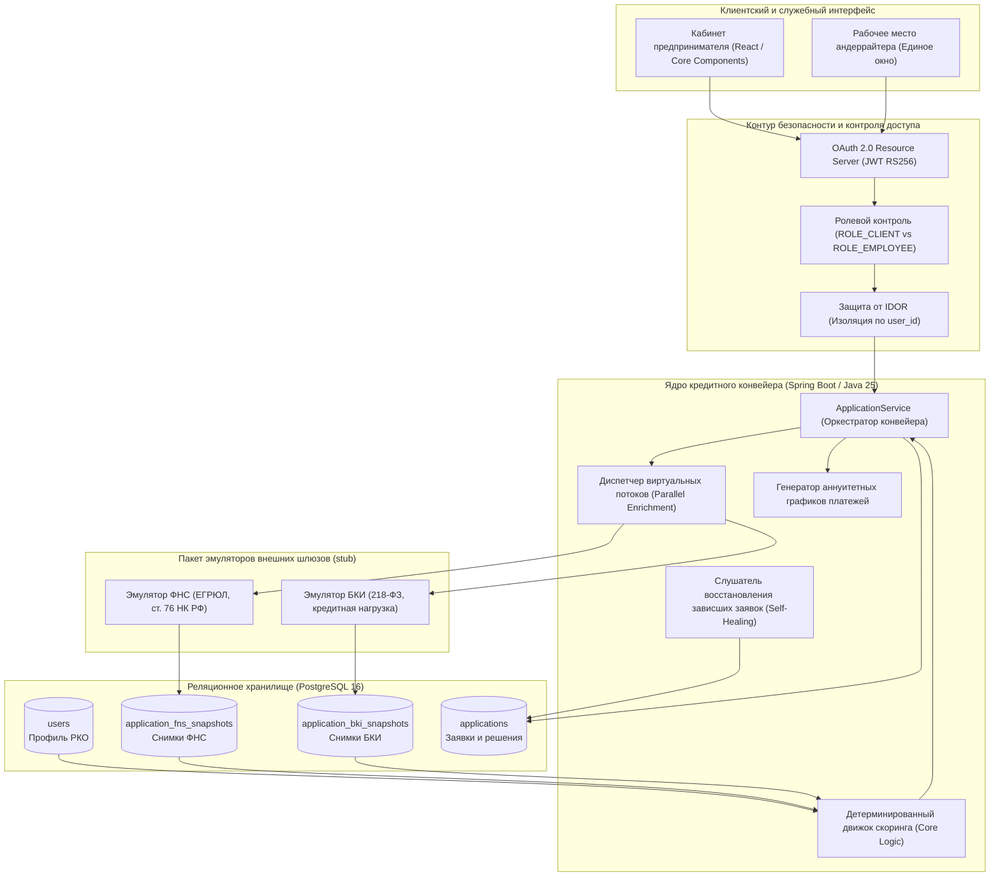

# Архитектура решения: Умный кредитный кабинет ММБ

## 1. Назначение системы и ключевые принципы

Система представляет собой цифровой кредитный конвейер малого и микробизнеса (ММБ) для автоматизации процесса кредитования: от подачи заявки предпринимателем до проверки стоп-факторов, расчета лимитов, скоринга и подписания кредитного договора в цифровом виде.

Система обслуживает две ключевые роли:
* **Клиент (Предприниматель / ЮЛ / ИП):** выбор условий, отправка заявки, просмотр графика платежей, принятие встречного предложения (контр-оффера) и подписание договора простой электронной подписью (ПЭП).
* **Сотрудник банка (Андеррайтер / Риск-офицер):** единое окно мониторинга кредитных заявок, детальный аудит досье заемщика (данные РКО, снимки ФНС и БКИ, скоринг-баллы, ПДН) и инструменты ручного разбора (повторный запуск при сбоях, ручное одобрение со ставкой и лимитом или мотивированный отказ).

---

## 2. Свойства надежности и безопасности системы (High-Level Overview)

Архитектура спроектирована с учетом реальных ситуаций, возникающих в банковской эксплуатации:

1. **Ролевое разграничение доступа (RBAC — Role-Based Access Control):**
   * В системе реализовано строгое разделение полномочий на уровне ролей `CLIENT` и `EMPLOYEE`.
   * Клиент имеет доступ только к личному кабинету заемщика и операциям со своими заявками. Он физически не может вызывать служебные методы андеррайтинга.
   * Сотрудник банка имеет доступ к реестру всех заявок и аналитическому досье, но не может подписывать кредитную документацию или подавать заявки от имени заемщика.

2. **Защита от несанкционированного доступа к чужим данным (Защита от IDOR):**
   * Каждый запрос заемщика проверяется на принадлежность именно текущему авторизованному пользователю.
   * Если пользователь попытается подставить в адресную строку браузера или сетевой запрос идентификатор чужой кредитной заявки, система не выдаст чужие данные, а вернет безопасный ответ `404 Not Found`. Банковская и коммерческая тайна полностью изолированы.

3. **Идемпотентность API и защита от повторных действий:**
   * Сеть может сбоить, а пользователь — случайно нажать кнопку «Подписать договор» или «Отправить заявку» несколько раз подряд.
   * Все критические действия в конвейере строго идемпотентны. Перевод заявки в подписанное состояние выполняется атомарно: договор подписывается ровно один раз, повторные клики и параллельные сетевые вызовы безопасно отклоняются без дублирования сделки.

4. **Кэширование межведомственных данных и независимость конвейера:**
   * Ответы внешних государственных и кредитных реестров (ФНС, БКИ) сохраняются в неизменяемые таблицы снимков (`application_fns_snapshots`, `application_bki_snapshots`).
   * Это решает сразу три задачи:
     1. *Юридический аудит (по 590-П ЦБ РФ):* банк фиксирует точный снимок финансового положения заемщика на момент принятия решения.
     2. *Экономия затрат:* конвейеру не требуется повторно опрашивать платные внешние реестры при каждом открытии карточки заявки андеррайтером.
     3. *Изоляция:* сбой одного внешнего шлюза не приводит к потере уже успешно собранных данных по другому шлюзу.

5. **Самовосстановление конвейера (Self-Healing):**
   * Если внешний шлюз (например, БКИ) временно не отвечает по таймауту, конвейер не ломается и не выдает пользователю фатальную ошибку. Заявка переводится на контроль сотруднику (`MANUAL_REVIEW`, код `TECH_FAILURE`).
   * Как только внешний шлюз восстановит работу, сотрудник перезапускает скоринг в один клик. Конвейер завершает опрос упавшего сервиса и выносит решение без необходимости для клиента заполнять заявку заново.
   * При аварийной перезагрузке сервера (рестарт контейнера) система автоматически находит незавершенные заявки в статусе `PROCESSING` и доводит их до решения.

6. **Устойчивость к нагрузке (Изоляция пула соединений БД):**
   * Медленные сетевые запросы к внешним системам выполняются асинхронно на виртуальных потоках и полностью вынесены за пределы транзакций базы данных. Внутренний пул соединений PostgreSQL (HikariCP) не удерживается во время сетевого ожидания, что исключает зависание конвейера.

---

## 3. Моделирование банковского контура и внешних связей

В рамках хакатона система реализована автономно, воспроизводимо и без необходимости доступа к закрытым боевым сетям:

1. **Сервис идентификации и авторизации (IdP / SSO):**
   * В реальном банке клиент авторизуется через корпоративный Identity Provider (Единая биометрическая система, Alfa ID, мобильный банк).
   * В архитектуре конвейера бэкенд выступает в роли стандартного OAuth 2.0 Resource Server с валидацией токенов RS256 (JWT). Для демонстрации и тестирования механизм выпуска токенов смоделирован внутри сервиса (`AuthService`), что позволяет мгновенно переключаться между тестовыми профилями клиентов и сотрудника.

2. **Межведомственные интеграции (Пакет `ru.alfahackaton.stub`):**
   * Интеграции с Федеральной налоговой службой (ФНС) и Бюро кредитных историй (БКИ) вынесены в обособленный пакет стабов (`stub`).
   * Эмуляторы работают по реалистичным протоколам, возвращая структурированные данные по ИНН заемщика: проверку на банкротство, блокировки счетов по ст. 76 НК РФ, рейтинг БКИ, наличие дефолтов и среднемесячный платеж по сторонним кредитам.
   * Эмуляторы полностью изолированы от основного бизнес-кода: при замене тестовых шлюзов на реальные REST/SOAP-адаптеры логика ядра конвейера не требует изменений.

---

## 4. Архитектурная топология компонентов

---

## 5. Детерминированная машина состояний заявки (State Machine)

Жизненный цикл заявки управляется строгой машиной состояний с контролем легитимности каждого перехода:

| Исходный статус | Целевой статус | Событие / Инициатор | Смысл бизнес-шага |
| :--- | :--- | :--- | :--- |
| *Новая* | `PROCESSING` | Клиент отправил заявку | Заявка зафиксирована в базе данных, запущен параллельный сбор досье. |
| `PROCESSING` | `APPROVED` | Скоринговый движок | Все проверки пройдены, балл $\ge 65$, лимит рассчитан. Готово к подписанию. |
| `PROCESSING` | `APPROVED` *(контр-оффер)* | Скоринговый движок | Заемщик надежен, но запросил больше лимита. Одобрена безопасная сумма `Limit_max`. |
| `PROCESSING` | `MANUAL_REVIEW` | Сбой шлюза (`TECH_FAILURE`) | Временный таймаут ФНС/БКИ. Снимок сохранен, ожидает перезапуска сотрудником. |
| `PROCESSING` | `MANUAL_REVIEW` | Пограничный скор (`BORDERLINE_SCORE`) | Балл 50–64 или заемщик III категории 590-П. Требуется мотивированное суждение. |
| `PROCESSING` | `REJECTED` | Жесткий стоп-фактор | Банкротство, арест счетов по 76 НК РФ, дефолт в БКИ либо балл $< 50$. |
| `MANUAL_REVIEW` | `PROCESSING` | Андеррайтер: вызов `/retry` | Повторный запуск скоринга после восстановления внешнего сервиса. |
| `MANUAL_REVIEW` | `APPROVED` | Андеррайтер: вызов `/approve` | Ручное подтверждение сделки с указанием суммы, ставки и комментария. |
| `MANUAL_REVIEW` | `REJECTED` | Андеррайтер: вызов `/reject` | Экспертный отказ с обязательной фиксацией причины в аудит-логе. |
| `APPROVED` | `SIGNED` | Клиент: ввод кода ПЭП | Заемщик акцептовал оферту. Договор заключен. Переход к выдаче. |

**Инвариант неизменяемости:** Статусы `REJECTED` и `SIGNED` являются терминальными состояниями. Любые попытки повторного изменения условий по ним отвергаются.

---

## 6. Идемпотентность и управление транзакциями

Для предотвращения состояний гонки (Race Conditions) и дублирования операций используются атомарные операции базы данных (Compare-And-Swap):

1. **Атомарное подписание договора (`signApplication`):**
   * Переход в статус `SIGNED` выполняется SQL-запросом с проверкой предусловия:
     `UPDATE applications SET status = 'SIGNED', ... WHERE id = :id AND status = 'APPROVED'`
   * Если пользователь отправляет два запроса одновременно, первый запрос обновляет статус и фиксирует договор, а второй получает 0 измененных строк и возвращает клиенту контролируемую ошибку конфликта `409 Conflict`, исключая двойное кредитование.

2. **Атомарный перезапуск конвейера (`retryApplication`):**
   * Перевод заявки из ручного разбора обратно в конвейер выполняется условием:
     `UPDATE applications SET status = 'PROCESSING' WHERE id = :id AND status = 'MANUAL_REVIEW' AND review_reason_code = 'TECH_FAILURE'`
   * Параллельные клики сотрудников по кнопке перезапуска не создают дублирующих очередей обработки.

3. **Разделение фаз сетевого I/O и транзакций БД:**
   * Внешние вызовы к ФНС и БКИ происходят **вне аннотаций `@Transactional`**.
   * Соединение с PostgreSQL открывается только на момент записи готового снимка или обновления статуса (занимает 1–2 мс), что гарантирует высокую устойчивость конвейера к задержкам сторонних сетей.
