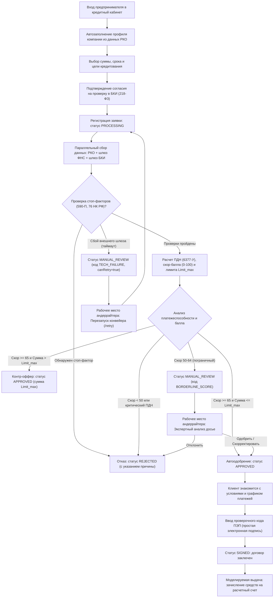

# Спецификация кредитного скоринга, продуктовой модели и риск-конвейера (Scoring & Underwriting Specification)

Настоящий документ определяет продуктовую модель, нормативно-правовую базу, состав входных данных, математический алгоритм оценки рисков и регламенты принятия решений цифрового кредитного конвейера малого и микробизнеса (ММБ) Альфа-Банка.

---

## 1. Бизнес-контекст и специфика сегмента ММБ

### 1.1. Кто такие субъекты ММБ
Малый и микробизнес (согласно Федеральному закону № 209-ФЗ) — это индивидуальные предприниматели и юридические лица с годовой выручкой до 120 млн ₽ (микробизнес) и до 800 млн ₽ (малый бизнес). В России зарегистрировано свыше 6,6 млн субъектов МСП.

В отличие от крупного корпоративного бизнеса:
* У предпринимателя нет штата финансовых директоров, бухгалтеров и юристов. Владелец совмещает управление продажами, закупками и операционной деятельностью.
* Потребность в деньгах возникает внезапно: кассовый разрыв из-за задержки оплаты контрагентом, выгодная партия товара с сезонной скидкой, срочный ремонт оборудования или обеспечение заявки на участие в тендере.
* Финансовая отчетность часто не отражает реальное положение дел в моменте (сдается раз в квартал или раз в год), тогда как обороты по банковскому расчетному счету показывают актуальный пульс бизнеса.

### 1.2. Проблематика классического кредитования бизнеса
Традиционный процесс корпоративного кредитования создавался для средних и крупных компаний, поэтому для малого бизнеса он сопряжен с существенными барьерами:
* **Бумажная волокита:** требование предоставить кипу справок, налоговых деклараций с отметками ФНС, выписок из других банков и договоров с контрагентами.
* **Непрозрачность рассмотрения («черный ящик»):** предприниматель отправляет документы и остается в неведении о том, на каком этапе находится обращение и есть ли шансы на одобрение.
* **Бинарный исход без альтернатив:** если сумма запроса превышает расчетный лимит даже на 10%, классический банк ставит автоматический отказ с мораторием на повторную подачу от 30 до 90 дней, вместо предложения доступной суммы.
* **Очный визит в отделение:** необходимость личной поездки руководителя в банковский офис для идентификации и физического подписания бумажных договоров.

### 1.3. Подход «Умного кредитного кабинета ММБ»
Кредитный конвейер Альфа-Банка устраняет эти барьеры за счет следующих принципов:
* **Zero-Input на базе данных РКО:** заемщик рассматривается как действующий клиент банка. Банк бесплатно и в режиме реального времени видит историю расчетного счета (кредитовые обороты, остатки, стаж). Клиенту не нужно вводить реквизиты компании вручную — анкета предзаполняется автоматически.
* **Мгновенный результат:** решение принимается алгоритмически за секунды за счет параллельного опроса реестров без ручного труда на первичном этапе.
* **Умный контр-оффер вместо отказа:** при нехватке оборотов под желаемую сумму система автоматически вычисляет максимально безопасный лимит и предлагает его заемщику в один клик.
* **Цифровая подпись онлайн (ПЭП):** подписание полного комплекта индивидуальных условий договора одноразовым кодом подтверждения прямо в интерфейсе кабинета без поездок в банк.
* **Прозрачное «Единое окно» андеррайтера:** нестандартные заявки (пограничный балл, технические сбои внешних шлюзов) направляются сотруднику банка, где все риск-факторы наглядно подсвечены, а решение принимается по четкому регламенту.

---

## 2. Каталог кредитных продуктов ММБ

Кредитный конвейер поддерживает продуктовую дифференциацию в зависимости от бизнес-цели заемщика:

| Продукт | Бизнес-назначение | Допустимая сумма | Срок погашения | Особенности графика и обеспечения |
| :--- | :--- | :--- | :--- | :--- |
| **Оборотный кредит** (`WORKING_CAPITAL`) | Пополнение оборотных средств, закупка сезонных партий товара, расчеты с поставщиками. | 100 000 – 10 000 000 ₽ | 3 – 36 месяцев | Равномерный аннуитетный график ежемесячных платежей. Без обязательного залога. |
| **Овердрафт** (`WORKING_CAPITAL` экспресс) | Оперативное закрытие кассовых разрывов при задержке поступлений от покупателей. | 100 000 – 3 000 000 ₽ | 1 – 12 месяцев | Лимит к расчетному счету. Автоматическое погашение за счет поступающей выручки. |
| **Инвестиционный кредит** (`EQUIPMENT`, `BUSINESS_EXPANSION`) | Покупка спецтехники, станков, коммерческого автотранспорта, открытие новых точек продаж. | 1 000 000 – 50 000 000 ₽ | 12 – 60 месяцев | Длительный срок кредитования. При суммах свыше 10 млн ₽ подлежит согласованию с андеррайтером. |
| **Рефинансирование** (`REFINANCING`) | Объединение и погашение дорогих кредитов сторонних банков для снижения ежемесячной нагрузки. | 300 000 – 15 000 000 ₽ | 6 – 36 месяцев | Направлено на замещение внешних кредитов из отчета БКИ с понижением долговой нагрузки ($ПДН$). |

---

## 3. Сквозной клиентский путь и сценарии взаимодействия (CJM)

### 3.1. Карта движения заявки

### 3.2. Роли участников процесса
1. **Заемщик (Клиент ММБ):** настраивает сумму и срок в калькуляторе, видит расчетный ежемесячный платеж, подтверждает передачу данных, принимает контр-оффер при снижении лимита и подписывает договор кодом ПЭП.
2. **Андеррайтер (Сотрудник кредитного департамента):** в интерфейсе «Единого окна» работает с заявками со статусом `MANUAL_REVIEW`. При сбоях шлюзов (`TECH_FAILURE`) выполняет повторный запрос (`retry`), при пограничном рейтинге (`BORDERLINE_SCORE`) оценивает стабильность бизнеса заемщика и принимает мотивированное решение об одобрении (`approve`) или отказе (`reject`).

---

## 4. Нормативно-правовая база конвейера

Логика конвейера строго соответствует законам РФ и нормативным актам Банка России:

1. **Положение Банка России № 590-П «О порядке формирования кредитными организациями резервов на возможные потери по ссудам»:**
   * Обязывает банк классифицировать все ссуды по 5 категориям качества.
   * *I категория (Стандартные, 0 дней просрочки):* резерв $0\%$ $\to$ зеленый коридор, мгновенное автоодобрение.
   * *II категория (Нестандартные, просрочка 1–30 дней):* резерв $1–20\%$ $\to$ одобрение с повышенной риск-надбавкой к процентной ставке ($+2.0\%$).
   * *III категория (Сомнительные, просрочка 31–90 дней):* резерв $21–50\%$ $\to$ обязательное ручное рассмотрение андеррайтером (`MANUAL_REVIEW`), автовыдача запрещена.
   * *IV–V категории (Проблемные и безнадежные, просрочка свыше 90 дней либо банкротство):* резерв $51–100\%$ $\to$ безусловный стоп-фактор, мгновенный отказ (`REJECTED`).
2. **Указание Банка России № 6377-У (Расчет показателя долговой нагрузки — ПДН):**
   * Банк обязан рассчитывать соотношение всех ежемесячных кредитных платежей заемщика к его чистому ежемесячному доходу.
   * Предельное допустимое значение для беззалогового кредитования составляет $50\%$. Превышение данного порога влечет формирование контр-оффера на безопасную сумму.
3. **Федеральный закон № 218-ФЗ «О кредитных историях»:**
   * Запрос кредитного отчета и среднемесячного платежа по внешним ссудам в сторонних банках допускается строго при наличии согласия субъекта кредитной истории. Срок действия согласия фиксируется на 6 месяцев.
4. **Статья 76 Налогового кодекса РФ (Приостановление операций по счетам):**
   * Наличие действующих решений налоговых органов о блокировке расчетных счетов заемщика является абсолютным юридическим запретом на выдачу кредита, так как предоставленные банком средства подлежат безакцептному списанию в пользу ФНС.
5. **Федеральный закон № 63-ФЗ «Об электронной подписи»:**
   * Моделирование подписания кредитного договора и графика платежей осуществляется с применением простой электронной подписи (ПЭП) с отправкой и фиксацией проверочного кода в единой сессии.

---

## 5. Реестр входных параметров

Конвейер использует строго 10 параметров из трех контуров. Сквозной ключ связывания — **ИНН заемщика**.

### А. Параметры заявки (ввод заемщика в кабинете)
| Параметр | Поле в API / БД | Тип | Диапазон | Значение |
| :--- | :--- | :--- | :--- | :--- |
| **Запрашиваемая сумма** | `amount` ($S_{req}$) | `BIGINT` | 100 000 – 50 000 000 ₽ | Желаемый объем финансирования. |
| **Запрашиваемый срок** | `term_months` ($T$) | `INT` | 1 – 60 месяцев | Желаемый срок кредита. |
| **Цель кредитования** | `loan_purpose` | `VARCHAR` | Enum | Бизнес-цель (`WORKING_CAPITAL`, `EQUIPMENT`, etc.). |

### Б. Внутренний контур (РКО Альфа-Банка)
*Обоснование:* Клиент ведет расчеты в Альфа-Банке, что позволяет банку бесплатно и объективно видеть реальные денежные потоки.
| Параметр | Поле в БД | Тип | Единица | Назначение |
| :--- | :--- | :--- | :--- | :--- |
| **ИНН заемщика** | `inn` | `VARCHAR` | 10/12 цифр | Сквозной ключ для межведомственных запросов. |
| **Годовой оборот** | `annual_turnover_rub` ($Rev_{yr}$) | `NUMERIC` | ₽ / год | Общий масштаб бизнеса за 12 месяцев. |
| **Среднемесячный оборот** | `avg_monthly_turnover_rub` ($Turnover$) | `NUMERIC` | ₽ / месяц | База для расчета чистого операционного потока. |
| **Стаж счета в банке** | `months_with_bank` ($Months$) | `INT` | месяцев $\ge 0$ | Длительность истории взаимоотношений с банком. |

### В. Внешний контур (Межведомственные шлюзы ФНС и БКИ)
| Параметр | Поле в БД | Источник | Обоснование |
| :--- | :--- | :--- | :--- |
| **Статус юрлица** | `state_status` | ФНС (ЕГРЮЛ) | Ст. 61 ГК РФ. Банкротство или ликвидация $\to$ *Стоп-фактор*. |
| **Блокировки счетов** | `tax_blocks_exist` | ФНС (Реестр 76 НК) | Ст. 76 НК РФ. Арест счетов $\to$ *Стоп-фактор*. |
| **Возраст бизнеса** | `business_age_months` | ФНС (Регистрация) | Менее 6 месяцев $\to$ повышенный риск дефолта. |
| **Платежи в др. банках** | `monthly_payment_rub` | БКИ (218-ФЗ) | Совокупная внешняя кредитная нагрузка. |
| **Текущая просрочка** | `current_overdue_days` | БКИ (218-ФЗ) | Определение категории качества ссуды по 590-П. |
| **Дефолты 90+ дней** | `cnt_overdue_over_90d` | БКИ (218-ФЗ) | Просрочка свыше 90 дней $\to$ *Стоп-фактор (IV-V категория)*. |
| **Кредитный рейтинг** | `bki_score` | БКИ (Скоринг) | Скоринговый балл титульного кредитного бюро (300–850). |

---

## 6. Алгоритм кредитного конвейера и математическая модель

Расчет выполняется в 4 последовательных этапа по принципу детерминированного конвейера.

### Этап 1. Жесткие стоп-факторы (Fail-Fast)
Если выполняется хотя бы одно из условий:
1. Организация находится в стадии банкротства или ликвидации (`state_status IN ('BANKRUPT', 'LIQUIDATING')`).
2. Имеются действующие решения налоговых органов о приостановлении операций (`tax_blocks_exist = true`).
3. Имеются исторические дефолты свыше 90 дней (`cnt_overdue_over_90d > 0`).
4. Текущая просроченная задолженность превышает 30 дней (`current_overdue_days > 30`).

**Решение:** конвейер мгновенно останавливает расчеты, заявка отклоняется со статусом **`REJECTED`**, причина фиксируется в поле `rejection_reason`.

### Этап 2. Расчет способности обслуживать долг (ПДН)
1. **Чистый ежемесячный доход заемщика ($Income_{net}$):**
   $$Income_{net} = Turnover \times 0.25$$
   *(Для малого бизнеса чистый операционный денежный поток после себестоимости и налогов консервативно принимается на уровне 25% от кредитового оборота).*

2. **Расчетный аннуитетный платеж по новой заявке ($Payment_{new}$):**
   $$Payment_{new} = S_{req} \times \frac{i \times (1 + i)^n}{(1 + i)^n - 1}$$
   где месячная процентная ставка $i = \frac{0.21}{12}$ (из расчета базовой ставки 21% годовых), $n = T$ (срок в месяцах).

3. **Показатель долговой нагрузки ($ПДН$ по Указанию ЦБ РФ № 6377-У):**
   $$ПДН = \frac{Payment_{existing} + Payment_{new}}{Income_{net}} \times 100\%$$

### Этап 3. Балльная скор-карта (0 – 100 баллов)
Интегральный балл формируется аддитивно из трех независимых факторов:
$$TotalScore = Score_{РКО} + Score_{БКИ} + Score_{ФНС}$$

| Компонент скоринга | Критерии оценки фактора | Начисляемый балл |
| :--- | :--- | :--- |
| **1. Фактор РКО (до 35 баллов)** | • Среднемесячный оборот $\ge 1\,000\,000$ ₽ • Среднемесячный оборот от 300 000 до 1 000 000 ₽ • Среднемесячный оборот менее 300 000 ₽ • Стаж расчетного счета в банке $\ge 12$ мес. • Стаж счета от 6 до 12 мес. • Стаж счета менее 6 мес. | +20 баллов +12 баллов +5 баллов +15 баллов +10 баллов +3 балла |
| **2. Фактор БКИ (до 35 баллов)** | • Рейтинг БКИ $\ge 700$ (высокая надежность) • Рейтинг БКИ от 600 до 699 (средняя надежность) • Рейтинг БКИ от 500 до 599 (удовлетворительно) • Рейтинг БКИ менее 500 | +35 баллов +25 баллов +15 баллов 0 баллов |
| **3. Фактор ФНС (до 30 баллов)** | • Возраст бизнеса $\ge 24$ месяцев • Возраст бизнеса от 12 до 24 месяцев • Возраст бизнеса от 6 до 12 месяцев | +30 баллов +20 баллов +10 баллов |

### Этап 4. Расчет лимита, процентной ставки и решение

1. **Безопасный лимит кредитования ($Limit_{max}$):**
   * *Лимит по обороту:* не более 30% годового кредитового оборота ($Rev_{yr} \times 0.30$).
   * *Лимит по долговой нагрузке:* предельный размер платежа не должен превышать 50% чистого дохода ($Payment_{avail} = 0.50 \times Income_{net} - Payment_{existing}$). По обратному финансовому аннуитету рассчитывается сумма долга.
   * Итоговый лимит принимается как минимум из двух величин:
     $$Limit_{max} = \min(Limit_{оборот},\; Limit_{ПДН})$$

2. **Индивидуальная процентная ставка ($Rate$):**
   Ставка формируется динамически от скорингового балла в коридоре от 16.5% до 23.5% годовых:
   $$Rate = 24.0\% - (TotalScore - 65) \times 0.15\%$$

---

## 7. Механизм формирования контр-оффера (Counter-Offer)

Контр-оффер активируется, когда заемщик благонадежен ($TotalScore \ge 65$, стоп-факторы отсутствуют), но запрошенная сумма превышает его расчетные финансовые возможности ($S_{req} > Limit_{max}$ либо $ПДН > 80\%$).

### Логика работы:
1. Заявка не отклоняется. Конвейер защищает клиента от кассового отказа.
2. В качестве одобренной суммы фиксируется безопасный лимит: `approved_amount = Limit_max`.
3. Заемщик видит встречное предложение в личном кабинете:
   * *«Запрошенная сумма 4 000 000 ₽ превышает расчетную нагрузку по текущим оборотам. Банк одобрил безопасный кредитный лимит 1 850 000 ₽ по ставке 18.5%. Вы можете принять эти условия в один клик»*.
4. Клиент может согласиться с контр-оффером и сразу перейти к подписанию договора на предложенную сумму.

---

## 8. Итоговая матрица решений конвейера

| Условие конвейера | Категория 590-П | Статус заявки | Одобренная сумма | Процентная ставка | Текст сообщения для клиента |
| :--- | :--- | :--- | :--- | :--- | :--- |
| **Сработал жесткий стоп-фактор** | IV или V | `REJECTED` | — | — | «Отказ: наличие проблемной задолженности в БКИ либо блокировки расчетных счетов по ст. 76 НК РФ» |
| **Недоступность шлюзов ФНС/БКИ** | — | `MANUAL_REVIEW` | — | — | «Проверка данных требует дополнительного времени. Заявка передана на контроль сотруднику» |
| **Скоринговый балл $< 50$** | III | `REJECTED` | — | — | «Отказ: недостаточный кредитный рейтинг бизнеса по совокупности факторов» |
| **Пограничный балл ($50 \le Score < 65$)** | II или III | `MANUAL_REVIEW` | — | — | «Заявка передана на индивидуальное рассмотрение кредитному эксперту банка» |
| **$Score \ge 65$ И $S_{req} \le Limit_{max}$** | I или II | `APPROVED` | $S_{req}$ | $Rate$ | «Заявка одобрена на запрошенных условиях» |
| **$Score \ge 65$ И $S_{req} > Limit_{max}$** | I или II | `APPROVED` *(контр-оффер)* | $Limit_{max}$ | $Rate$ | «Сформировано встречное предложение: вам одобрен кредитный лимит [Limit_max] ₽» |

---

## 9. Регламент работы андеррайтера по заявкам в статусе MANUAL_REVIEW

Перевод заявки в статус `MANUAL_REVIEW` происходит по двум принципиально разным причинам:

### 9.1. Технический сбой внешнего шлюза (`review_reason_code = TECH_FAILURE`)
* **Причина:** таймаут сетевого ответа (более 1500 мс) или ошибка внешнего сервиса ФНС/БКИ при первичном сборе данных.
* **Регламент сотрудника:**
  1. Андеррайтер открывает досье и проверяет сохраненные частичные снимки.
  2. Если внешний шлюз возобновил работу, сотрудник нажимает кнопку **«Перезапустить скоринг»** (`POST /api/v1/employee/applications/{id}/retry`).
  3. Конвейер повторно опрашивает упавший сервис и автоматически завершает расчет без повторного ввода данных клиентом.

### 9.2. Пограничный скоринг или контр-оффер (`review_reason_code = BORDERLINE_SCORE`)
* **Причина:** заемщик набрал от 50 до 64 баллов либо относится к III категории качества ссуд (были задержки оплат до 30 дней).
* **Регламент сотрудника:**
  1. Анализ досье: оценка динамики поступлений по счету РКО и факторов БКИ.
  2. **Сценарий одобрения (`POST /api/v1/employee/applications/{id}/approve`):** сотрудник указывает согласованную сумму `approvedAmount`, процентную ставку `approvedRate` и обязательное служебное обоснование в поле `comment` (например: *«Обороты за последние 3 месяца стабильны, заемщик предоставил закрывающие акты. Согласован лимит 1.5 млн ₽»*). Заявка переходит в `APPROVED`.
  3. **Сценарий отказа (`POST /api/v1/employee/applications/{id}/reject`):** при выявлении повышенных рисков сотрудник отклоняет заявку с обязательным комментарием в поле `comment`. Заявка переходит в `REJECTED`.

---

## 10. Примеры сквозных сценариев конвейера (Synthetic Personas)

Для верификации работы математической модели и интеграционной связки используются 4 синтетических профиля:

### Сценарий 1. «Зеленый коридор» (Автоодобрение)
* **Компания:** ООО «Альфа-Трейд» (ИНН `7701234567`). Стаж в банке: 18 месяцев.
* **Финансы:** Среднемесячный оборот по РКО: 2 500 000 ₽. Внешние кредиты в БКИ: 40 000 ₽/мес.
* **Проверки:** Блокировок счетов нет, возраст бизнеса 36 мес., рейтинг БКИ 740, просрочек нет (I категория 590-П).
* **Запрос:** 2 000 000 ₽ на 12 месяцев.
* **Расчет конвейера:**
  * Чистый доход: $2\,500\,000 \times 0.25 = 625\,000$ ₽/мес.
  * Новый платеж: ~186 200 ₽/мес.
  * $ПДН = \frac{40\,000 + 186\,200}{625\,000} \times 100\% = 36.2\%$ (норма $\le 50\%$).
  * Скоринговый балл: РКО (20+15) + БКИ (35) + ФНС (30) = **100 баллов**.
  * Безопасный лимит: $Limit_{max} = 2\,920\,000$ ₽ $> S_{req}$.
* **Результат:** Статус **`APPROVED`**. Одобрено 2 000 000 ₽ по ставке 18.8% годовых.

### Сценарий 2. «Контр-оффер» (Одобрение с безопасным лимитом)
* **Компания:** ИП Иванов А.В. (ИНН `5001234567`). Стаж в банке: 8 месяцев.
* **Финансы:** Среднемесячный оборот: 600 000 ₽. Внешние кредиты: 20 000 ₽/мес.
* **Проверки:** Нарушений нет, рейтинг БКИ 620, просрочек нет.
* **Запрос клиента:** 4 000 000 ₽ на 24 месяца (завышенный запрос).
* **Расчет конвейера:**
  * Чистый доход: $600\,000 \times 0.25 = 150\,000$ ₽/мес.
  * При сумме 4 млн расчетный платеж составил бы ~205 000 ₽, что дает $ПДН > 100\%$.
  * Скоринговый балл: РКО (12+10) + БКИ (25) + ФНС (20) = **67 баллов** (надежный клиент).
  * Расчет безопасного лимита: допустимый свободный платеж $150\,000 \times 0.50 - 20\,000 = 55\,000$ ₽/мес.
  * Безопасный лимит по обратному аннуитету: $Limit_{max} = 1\,020\,000$ ₽.
* **Результат:** Статус **`APPROVED` (контр-оффер)** на сумму 1 020 000 ₽. Клиент видит альтернативное предложение.

### Сценарий 3. «Жесткий стоп-фактор» (Мгновенный отказ)
* **Компания:** ООО «Нева-Транс» (ИНН `7801234567`).
* **Проверки:** В снимке БКИ зафиксирован факт дефолта (наличие просроченной задолженности свыше 90 дней, IV категория 590-П).
* **Результат:** Конвейер срабатывает по правилу Fail-Fast на этапе 1. Статус **`REJECTED`** без перехода к расчету лимита и ставок. В карточке фиксируется причина отказа.

### Сценарий 4. «Технический сбой и самовосстановление» (Self-Healing)
* **Компания:** ООО «Восток-Сервис» (ИНН `6601234567`).
* **Событие:** Шлюз БКИ не ответил в пределах таймаута 1500 мс. Шлюз ФНС ответил успешно.
* **Поведение конвейера:**
  * Успешный снимок ФНС сохранен в базе данных.
  * Заявка не падает с ошибкой, а переходит в статус **`MANUAL_REVIEW`** с кодом `TECH_FAILURE` и признаком `canRetry = true`.
  * Андеррайтер видит карточку, нажимает «Перезапустить скоринг» (`POST .../retry`).
  * Конвейер повторно опрашивает сервис и переводит заявку в финальный статус `APPROVED`.
